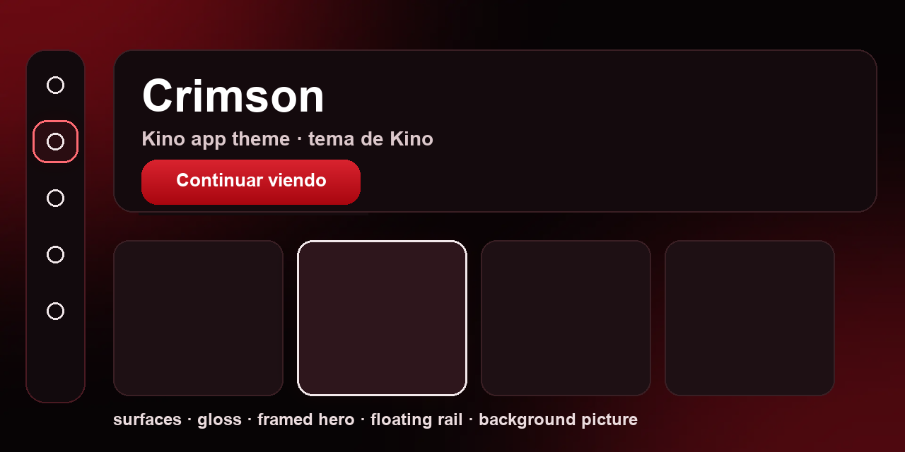

# Crimson — a theme for Kino / un tema para Kino

**EN** — A red app theme for [Kino](https://github.com/kinotvapp/kino-light): glossy and gradient buttons, glowing rings, a soft glow on
the cards, a framed hero and a floating rail on the TV, and a background picture. It also works as a complete, unsigned **example of the
painted-theme keys** (`surfaces`, `style.gloss`, `layout`, `assets`, `background.image`, `shape.heroRadius`, `shape.railItemRadius`;
apiVersion 26, Kino 0.9.87, not published yet): see the guide, <https://kinotvapp.github.io/kino-plugins/en/themes/#level2>.

**ES** — Un tema rojo para Kino: botones brillantes y degradados, anillos con resplandor, un resplandor suave en las tarjetas, un héroe
enmarcado y un riel flotante en la TV, y una imagen de fondo. También sirve de ejemplo completo y sin firma de las claves de los temas
que pintan (apiVersion 26, Kino 0.9.87, todavía sin publicar): <https://kinotvapp.github.io/kino-plugins/themes/#level2>.

## Install / Instalar

In Kino: **Plugins ▸ Agregar**, then type / escribe: `kinotvapp/kino-plugin-theme-crimson`. After installing, choose **Activar tema**, or later
in **Ajustes ▸ App ▸ Apariencia**. Each effect can be turned off one by one in **Ajustes ▸ Experiencia visual** (the *Rendimiento* tile
of the plugins panel on the TV), and the theme still looks right without them.

It needs a Kino that reads `apiVersion` 26; an older Kino does not list it. / Necesita un Kino que lea `apiVersion` 26; uno anterior no lo lista.

## Files / Archivos

- `kino-plugin.json`: the theme, as data (no code runs). / el tema, como datos.
- `plugin.js`: a minimal entry that does nothing. / una entrada mínima que no hace nada.
- `assets/background.webp`: the background picture, hash-checked by Kino at install. / la imagen de fondo, con su hash comprobado al instalar.
- `icon.png`, `preview.png`.

Check it with the kit / Compruébalo con el kit: <https://github.com/kinotvapp/kino-plugin-sdk> · `node sdk/validate.mjs .`

